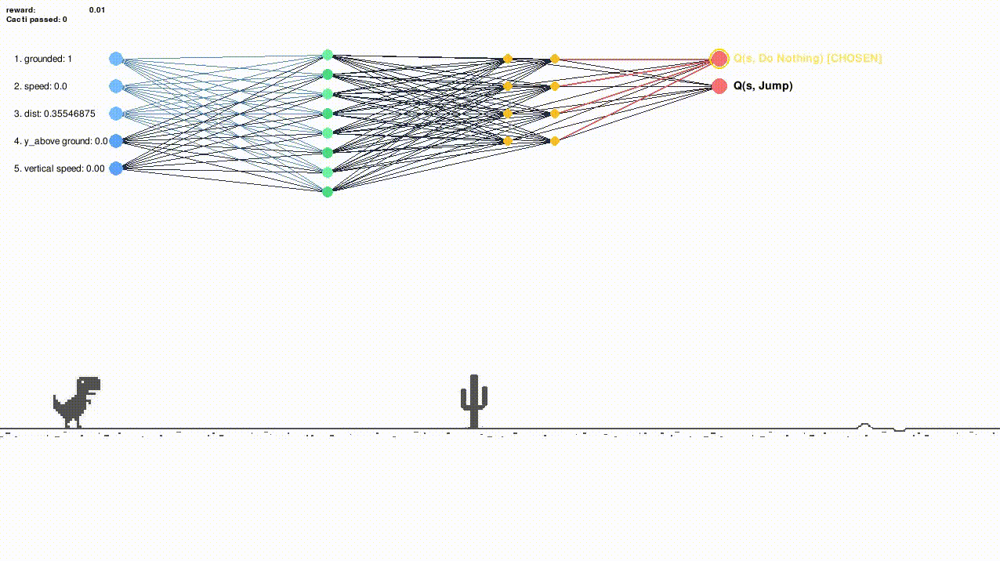
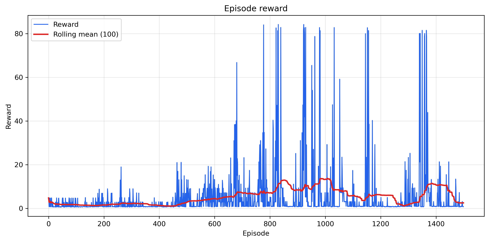
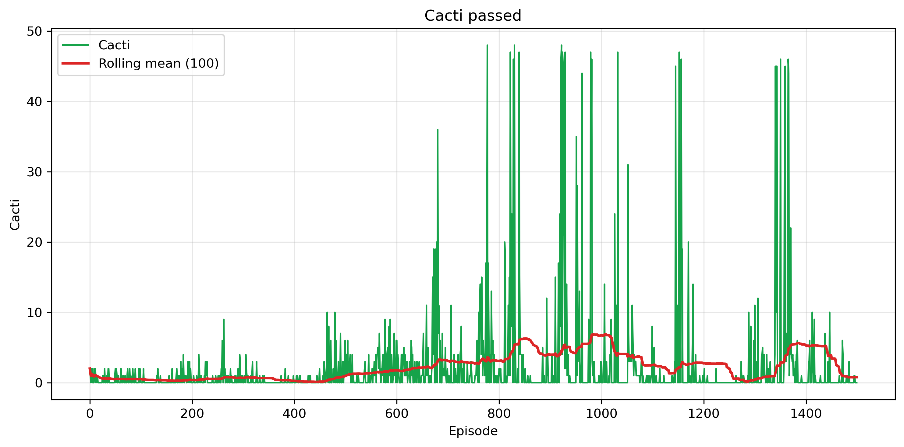
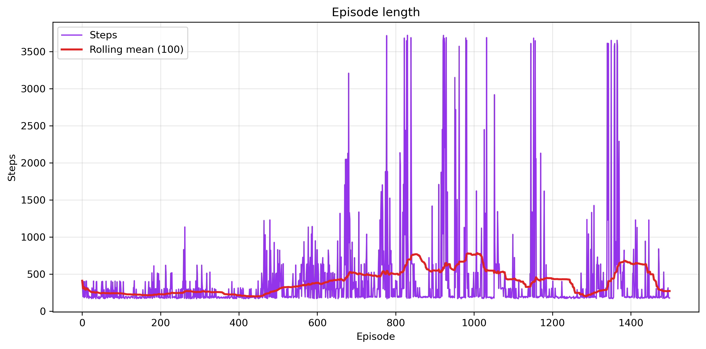
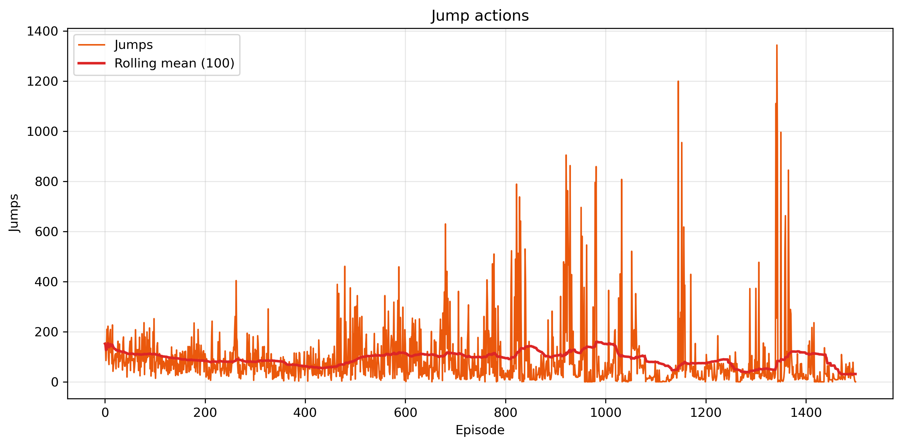
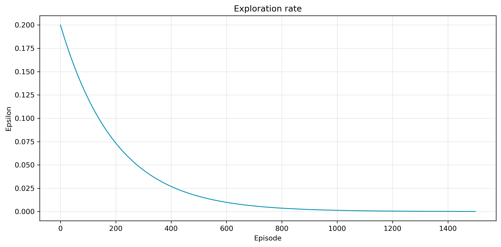

# DinoNEATRL

> A note from me:
>
> I started this project to challenge myself to learn something new that interested me. I wanted to not use AI as a way to get back to the basics and really struggle with something. It was really fun implementing the game from scratch using pygame (something that could be one prompted nowadays). I started a new module in university where we explored neural networks and thought this would be a cool application of it. It has been a long standing goal of mine since I started programming to try and teach a computer how to play a game (inspired by Code Bullet, Green Code and commonLuke)

## What this project does

This is a recreation of the Offline Chrome endless runner but a DQN agent plays the game.

You can:

- train a new model from scratch
- keep training from a saved checkpoint
- watch the trained model play automatically
- look at training metrics like reward, cacti passed, jumps, and exploration rate

The gameplay loop is pretty simple but has now been lost in the implementation of the network. The agent chooses between jumping and staying on the ground and through "episodes" learns what a "good" run looks like through reward shaping and a replay memory buffer of previous runs.

## Demo



When you run the dino on the best model, a network is visualised while it completes the run to better visualise how decisions are made. This neural network visualisation was generated by AI (because calculating line and circle geometry is boring and difficult)

## Assets and Graphs

### Game assets


### Training graphs

These graphs are generated once the dino has completed it's training from a specified number of episodes. 

It's interesting to see how (for example) in [Episode reward] the episode rolling mean does increase but after 1100 episodes it ends up getting worse. This in the end doesn't matter as I save the best model after each episode (provided it beat the current best model). 

I do think this is an error on my part in either how the model learns from past experience or (the more likely reason) the game becomes impossible. 

After cactus ~45 the game becomes to fast and the dino almost always lands on the cactus. This is a game design flaw. It shouldn't become impossible but rather reach a limit and then it becomes a game of stamia (which the dino should do well in)







## Getting started
 
### Requirements

This repo uses Python 3.13.5.

Install the dependencies:

```bash
pip install -r requirements.txt
```

### Train a model

```bash
python main.py --episodes 1000
```

This starts a training run and saves the best model into `models/`. Training metrics and graphs are saved in `results/`, and each run’s best model filename includes a timestamp so it’s easy to tell what happened when.

### Continue training

```bash
python main.py --continue --episodes 1000
```

This loads the most recent `best_model*.pt` model in `models/` and continues training from there. It saves a new model with a timestamped filename instead of overwriting the old one.

### Watch a model play

```bash
python main.py --play models/best_model_YYYYMMDD_HHMMSS.pt
```

This runs the game in play mode using a saved specified model.

## How it works

The technique used is Deep Q-Network. It is a value-based reinforment learning algorithmn that combines Q-Learning with nueral networks

The network architecture is small since the game is very simple:

- input layer: 5 state features
- hidden layer: 256 ReLU units
- dueling heads: one stream estimates the state value, another estimates action advantages
- output layer: 2 actions (jump, no jump)

To better explain what "dueling heads" means. It splits the last connected layer into two streams:

- how good the current state is
- how much better one action is than the others in that state

This better teaches the network what states are "good" to be in no matter that next action you take. This allows the model to generalise better.

The state vector is:

- grounded or not
- game speed
- distance to the next cactus
- dino height above the ground
- dino vertical velocity

The reward function I finished on took a lot of trial and error. The agent gets a small reward for surviving each step, a extra reward for passing a cactus, negative reward for jumping at the wrong moment and a HUGE negative reward for hitting into a cactus. The penalty for unecessary jumping was essential, because the dino kept getting lucky and making it far by just spamming the jump - so I had to focus on discouraging unecessary jumps. 

Another interesting strategy implemented was the "epsilon-greedy algorithmn" used in training. 
At each decision step when the dino makes an action, it can either explore (with prob. epsilon) or exploite (with prob. 1 - epsilon). This prob. then decays over time. The point is to encourage the dino to explore more actions in the beginning of training to find out better rewards. Later in the training it starts relying more on the trained network instead of exploring more options. (this could be why my model doesn't learn later in episodes). 

This exploration graph can be see in the training graphs.

## Limitations

- the model doesn't seem to learn any more after ~1100 episodes
- the game becomes impossible to continue given the speed increases

## What I learned

The biggest thing I learned by far was that no amount of training will make a poor reward function work. I spent half the time just tweaking what it was rewarded for. I tried penalising the number of jumps before it reached a cactus or penalised it for trying to jump while it was still in the air. After some time, I found a reward function that worked. 

## Acknowledgements

This project was inspired by youtubers like Code Bullet, Green Code and commonLuke. 

The single most important article I used:

- [DQN modelling reference](https://medium.com/@mathparracho/training-an-agent-to-play-flappy-bird-dqn-modelling-reinforcement-learning-2cb16a9fa184)


- [pygame docs](https://www.pygame.org/docs/)
- [geeks for geeks flappy bird](https://www.geeksforgeeks.org/python/how-to-make-flappy-bird-game-in-pygame/)
- [akbar ali flappy bird](https://dev.to/akbrews/creating-flappy-bird-with-pygame-part-1-11kd)